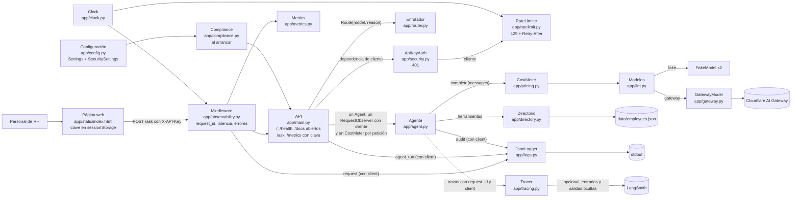
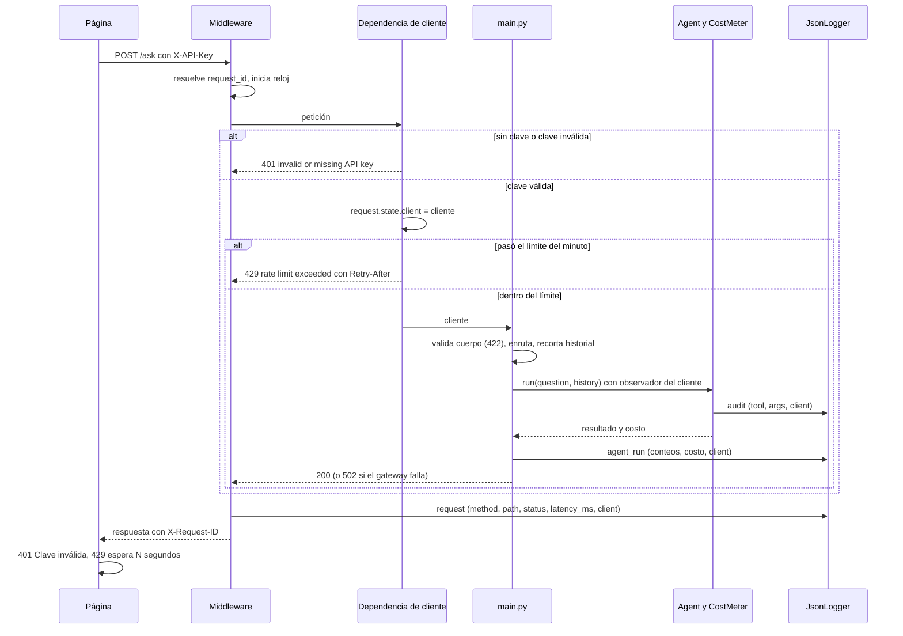
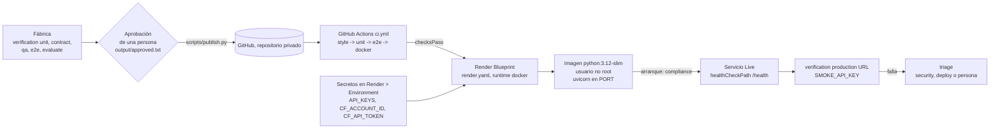

# Arquitectura del HR Assistant

Asistente de Recursos Humanos que responde preguntas sobre empleados desde una página web.
API FastAPI sin estado de negocio, un solo agente con bucle con tope y un modelo detrás de una
interfaz. Desde la sesión 2, cada petición se puede rastrear (id, log JSON, auditoría, trazas) y
medir (`/metrics`). Desde la sesión 3, cada respuesta dice qué modelo usó, por qué y cuánto costó.
Desde la sesión 4, solo entra quien tiene clave, cada cliente tiene un límite por minuto, la
configuración de producción se revisa al arrancar y el producto se publica en Render solo si el
pipeline de CI pasa.

## Componentes

## Una petición a `/ask`

## Del código a producción

## Principios

- Sin estado de negocio: el historial vive en el navegador (ADR 0001).
- El agente solo conoce `complete(messages)` (ADR 0002) y un observador opcional (ADR 0006).
- Bucle con tope y herramientas de solo lectura (ADR 0003).
- Un `request_id` por petición y log JSON sin texto de preguntas ni respuestas (ADR 0004).
- Métricas en memoria de cada proceso, identificadas por `pid`, con costo acumulado (ADR 0005).
- Trazas en LangSmith opcionales, con entradas y salidas ocultas por omisión (ADR 0006).
- Enrutamiento por regla, modelo real por AI Gateway y costo medido (ADR 0007, 0008 y 0009).
- Una clave por cliente en una dependencia de ruta; la clave nunca se escribe, solo el nombre del
  cliente (ADR 0010).
- Límite por cliente en memoria con reloj inyectado; con varias copias se multiplica (ADR 0011).
- Compliance al arrancar con `ENVIRONMENT=production`; publicación solo con aprobación humana y CI en
  verde (ADR 0012). Detalle en `doc/compliance-checklist.md`.
- Inyección de dependencias en `create_app(settings, model, directory, observability, models)`; la
  hora llega por un `Clock` inyectado.

## Variables de la sesión 4

| Variable | Por omisión | Dónde actúa |
| --- | --- | --- |
| `ENVIRONMENT` | `development` | `compliance.py`; solo `development` o `production` |
| `API_KEYS` | vacía | `security.py`; secreto, `sync: false` en Render |
| `RATE_LIMIT_PER_MINUTE` | `30` | `ratelimit.py` |

## Dónde mirar

- Log: la salida estándar del proceso (en Render, la pestaña Logs); se filtra por `request_id` o por
  `client`.
- Métricas: `GET /metrics` con una clave; el `pid` dice de qué copia vienen.
- Pipeline: la pestaña Actions del repositorio, una etapa por trabajo.
- Producción: `uv run python -m verification production <url>` con `SMOKE_API_KEY` en el entorno.
