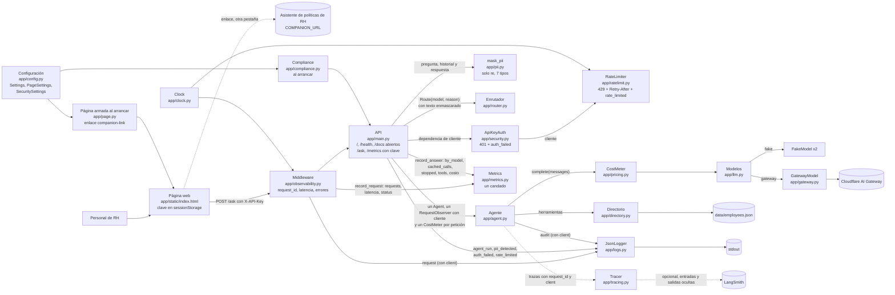
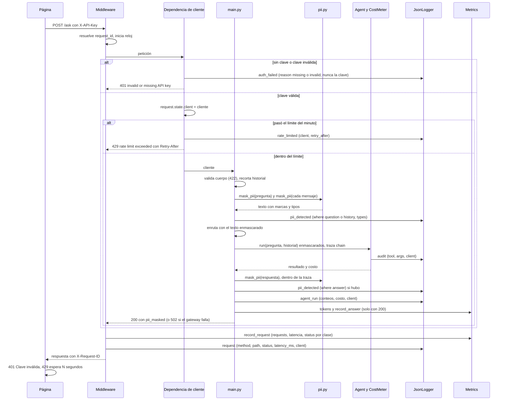
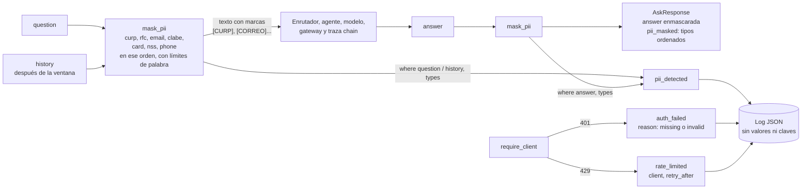
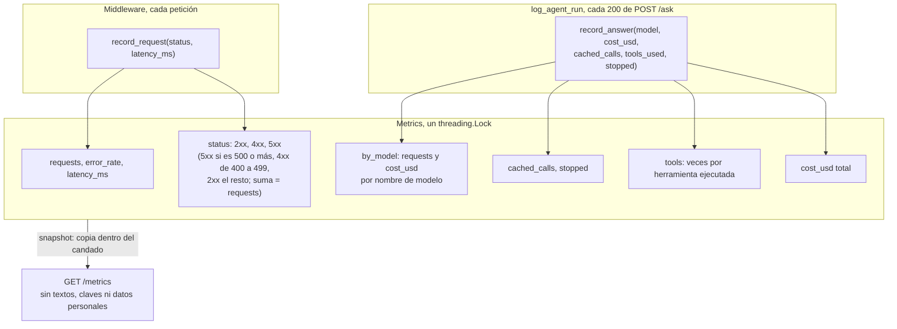
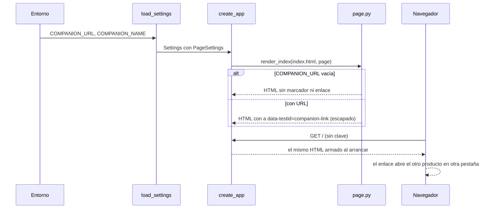
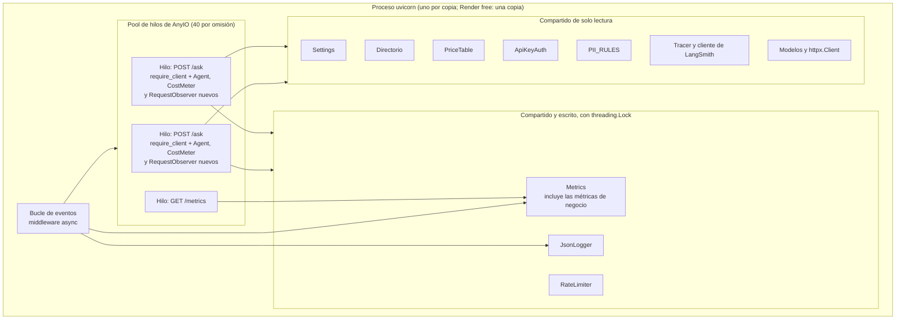
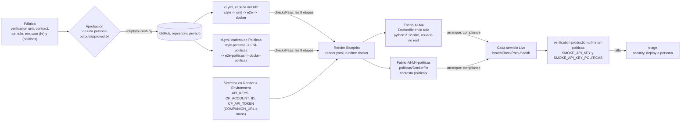
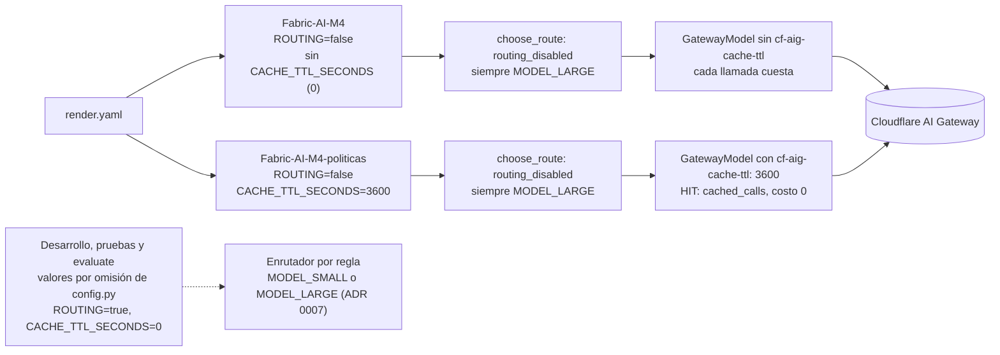

# Arquitectura del HR Assistant

Asistente de Recursos Humanos que responde preguntas sobre empleados desde una página web.
API FastAPI sin estado de negocio, un solo agente con bucle con tope y un modelo detrás de una
interfaz. Desde la sesión 2, cada petición se puede rastrear (id, log JSON, auditoría, trazas) y
medir (`/metrics`). Desde la sesión 3, cada respuesta dice qué modelo usó, por qué y cuánto costó.
Desde la sesión 4, solo entra quien tiene clave, cada cliente tiene un límite por minuto, la
configuración de producción se revisa al arrancar y el producto se publica en Render solo si el
pipeline de CI pasa. Desde la especificación 05, queda escrito por qué atiende peticiones
simultáneas y la página enlaza con el segundo producto, el Asistente de políticas de RH. Desde la
especificación 06, ese segundo producto vive en `politicas/` del mismo repositorio y se publica como
otro servicio del mismo Blueprint; el código del HR no cambia (ver `politicas/doc/architecture.md`).
Desde la especificación 07, `/metrics` también dice cómo se usa el producto y cuánto cuesta cada
modelo: respuestas y costo por modelo, llamadas de caché, respuestas cortadas, herramientas y clases
de código HTTP (ADR 0015 y 0016), igual en los dos productos. Desde la especificación 08, la
configuración de producción de `render.yaml` manda todas las preguntas al modelo grande en los dos
servicios y enciende la caché del gateway solo en Políticas (ADR 0017); el código no cambia. Desde la
especificación 09, los datos personales de la pregunta, el historial y la respuesta se enmascaran
con `app/pii.py`, la respuesta dice qué tipos se enmascararon (`pii_masked`) y el log audita los
rechazos de clave, los de límite y la PII, nunca sus valores (ADR 0018).

## Componentes

## Una petición a `/ask`

## Datos personales y auditoría

Desde la especificación 09 (ADR 0018). `app/pii.py` es el único lugar que conoce los patrones; `main.py` es el
único que lo llama, porque todo el texto de una petición pasa por ahí. El valor detectado nunca sale de `mask_pii`:
eventos, trazas, métricas y respuesta solo llevan el tipo.

| Tipo | Marca | Tipo | Marca |
| --- | --- | --- | --- |
| `curp` | `[CURP]` | `card` | `[TARJETA]` |
| `rfc` | `[RFC]` | `nss` | `[NSS]` |
| `email` | `[CORREO]` | `phone` | `[TELEFONO]` |
| `clabe` | `[CLABE]` | | |

La pregunta con PII no se rechaza. Las trazas `llm` guardan el texto del modelo, que solo recibió texto
enmascarado; en producción, con trazas encendidas, compliance exige ocultar entradas y salidas (ADR 0006 y 0012).

## Métricas de negocio

Los cinco campos de la especificación 07 viven en `Metrics`, bajo el mismo candado que `requests`,
latencia, tokens y costo (ADR 0015). Cada uno se suma en un solo punto (ADR 0016). La especificación
09 no agrega métricas.

## La página y el enlace al otro producto

## Peticiones simultáneas

Un solo proceso uvicorn por copia. Lo que se escribe entre peticiones lleva candado; lo demás es de
solo lectura o vive solo durante una petición (ADR 0013). Las métricas de negocio no agregan otro
objeto compartido: van dentro de `Metrics` (ADR 0015). Los patrones de `pii.py` se compilan una vez y
son de solo lectura.

Límite conocido: métricas y límite de peticiones viven en la memoria de cada proceso; con varias
copias, cada una lleva su propia cuenta. Más de 40 peticiones a la vez esperan turno.

## Del código a producción

Desde la especificación 06, `render.yaml` y `ci.yml` son de los dos servicios. El bloque del HR y sus
cuatro etapas no cambian; se agregan el servicio y las etapas de Políticas (ADR 0001 de Políticas).

## Configuración de producción

Desde la especificación 08, `render.yaml` fija dos palancas de costo de la sesión 3 con los datos de
la medición con el modelo real (ADR 0017). El código y los valores por omisión no cambian: en
desarrollo, en las pruebas y en `verification evaluate` el enrutamiento sigue encendido y la caché
apagada, para seguir midiendo las palancas.

| Variable | HR en producción | Políticas en producción | Por omisión |
| --- | --- | --- | --- |
| `ROUTING` | `false` | `false` | `true` |
| `CACHE_TTL_SECONDS` | no se define (0) | `3600` | `0` |
| `HISTORY_WINDOW` | por omisión | por omisión | `6` |
| `MODEL_MAX_TOKENS` | por omisión | por omisión | `300` |

El HR no lleva caché porque responde con datos de empleados: cachearlos guardaría datos personales en
Cloudflare y una respuesta vieja podría mostrar un dato que ya cambió. `CACHE_TTL_SECONDS` no se
agrega a mano en Render > Environment del HR.

## Principios

- Sin estado de negocio: el historial vive en el navegador (ADR 0001).
- El agente solo conoce `complete(messages)` (ADR 0002) y un observador opcional (ADR 0006).
- Bucle con tope y herramientas de solo lectura (ADR 0003).
- Un `request_id` por petición y log JSON sin texto de preguntas ni respuestas (ADR 0004).
- Métricas en memoria de cada proceso, identificadas por `pid`, con costo acumulado (ADR 0005).
- Métricas de negocio en la misma `Metrics` y el mismo candado; nunca influyen en una respuesta y no
  llevan textos, claves ni datos personales (ADR 0015). `status` se suma junto con `requests`; lo demás,
  una vez por cada `200` de `/ask` con los datos del evento `agent_run` (ADR 0016).
- Trazas en LangSmith opcionales, con entradas y salidas ocultas por omisión (ADR 0006).
- Enrutamiento por regla, modelo real por AI Gateway y costo medido (ADR 0007, 0008 y 0009). En
  producción el enrutamiento está apagado en los dos servicios y la caché del gateway solo se usa en
  Políticas; el código del enrutador se conserva para una medición futura (ADR 0017).
- Una clave por cliente en una dependencia de ruta; la clave nunca se escribe, solo el nombre del
  cliente (ADR 0010). Un rechazo deja `auth_failed` con su motivo (ADR 0018).
- Límite por cliente en memoria con reloj inyectado; con varias copias se multiplica (ADR 0011). Un
  rechazo deja `rate_limited` con el cliente y la espera (ADR 0018).
- Compliance al arrancar con `ENVIRONMENT=production`; publicación solo con aprobación humana y CI en
  verde (ADR 0012). Detalle en `doc/compliance-checklist.md`.
- Peticiones simultáneas en el pool de hilos de FastAPI; solo métricas, log y límite se comparten y
  escriben, con candado (ADR 0013).
- El enlace al otro producto se arma en el servidor al arrancar, escapado y en otra pestaña; sin
  `COMPANION_URL` no aparece (ADR 0014).
- Datos personales detectados solo con `re` en `app/pii.py` y enmascarados en `main.py` antes del
  enrutador, el agente y la traza, y en la respuesta antes de devolverla; nunca se rechaza la pregunta
  ni se registra el valor (ADR 0018).
- Políticas no importa nada de `app/`: copia sus módulos y se construye con su propia carpeta; un
  fallo de sus etapas de CI también frena la publicación del HR (ADR 0001 y 0002 de Políticas).
- Inyección de dependencias en `create_app(settings, model, directory, observability, models)`; la
  hora llega por un `Clock` inyectado.

## Variables de la sesión 4

| Variable | Por omisión | Dónde actúa |
| --- | --- | --- |
| `ENVIRONMENT` | `development` | `compliance.py`; solo `development` o `production` |
| `API_KEYS` | vacía | `security.py`; secreto, `sync: false` en Render |
| `RATE_LIMIT_PER_MINUTE` | `30` | `ratelimit.py` |

## Variables de la especificación 05

| Variable | Por omisión | Dónde actúa |
| --- | --- | --- |
| `COMPANION_URL` | vacía | `page.py`; vacía: sin enlace. En Render se escribe a mano en Environment |
| `COMPANION_NAME` | `Asistente de políticas de RH` | `page.py`; texto del enlace |

La especificación 07 no agrega variables. La especificación 08 tampoco: fija en `render.yaml` el valor
de producción de `ROUTING` y `CACHE_TTL_SECONDS` (tabla de «Configuración de producción»). La
especificación 09 tampoco: el enmascaramiento y la auditoría siempre están encendidos.

## Dónde mirar

- Log: la salida estándar del proceso (en Render, la pestaña Logs); se filtra por `request_id` o por
  `client`. Los rechazos se buscan por `auth_failed` (`reason`) y `rate_limited` (`client`,
  `retry_after`); la PII enmascarada, por `pii_detected` (`where`, `types`).
- Métricas: `GET /metrics` con una clave; el `pid` dice de qué copia vienen. Uso y costo por modelo en
  `by_model`, herramientas en `tools`, respuestas cortadas en `stopped`, caché en `cached_calls` y
  clases de código en `status`. En producción `by_model` solo muestra `MODEL_LARGE`, `cached_calls`
  queda en 0 en el HR y la latencia del modelo grande se vigila con `latency_ms` y `slo`.
- Respuestas de `/ask` en producción: `route` es `routing_disabled` y `model` es `MODEL_LARGE`;
  `pii_masked` lista los tipos enmascarados.
- Configuración de producción: `render.yaml`; la comprueba `verification/contract/test_contract_08.py`.
- PII y auditoría: `verification/contract/test_contract_09.py`; controles en `doc/compliance-checklist.md`.
- Documentación de la API: Swagger en `/docs`, abierto sin clave, con «Authorize» para `X-API-Key`.
- Pipeline: la pestaña Actions del repositorio, una etapa por trabajo; las de Políticas terminan en
  `-politicas`.
- Producción: `uv run python -m verification production <url-hr> <url-politicas>` con `SMOKE_API_KEY`
  y `SMOKE_API_KEY_POLITICAS` en el entorno (solo la URL del HR si Políticas aún no está publicada).
