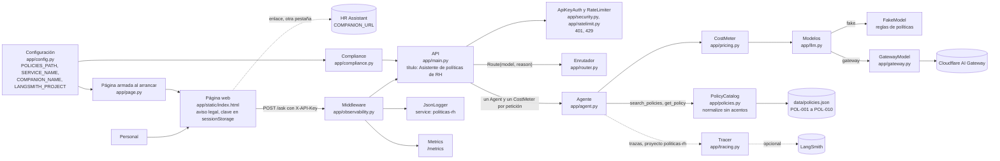
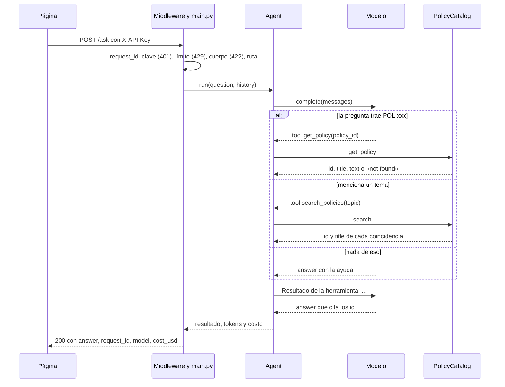
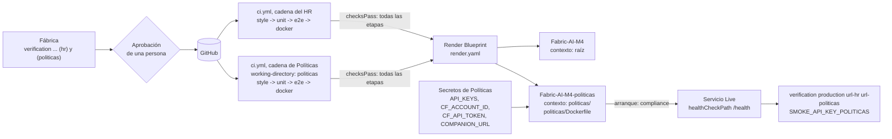

# Arquitectura del Asistente de políticas de RH

Asistente que responde preguntas del personal sobre las políticas de la empresa (vacaciones, aguinaldo, jornada,
permisos y otras) y cita siempre la política que usó. Es el HR Assistant de `product/` con otros datos, otras dos
herramientas y otro modelo simulado (especificación 06). Hereda sus decisiones: los ADR 0001 a 0014 del HR
Assistant (`product/doc/adr/`) valen igual aquí. Vive en `product/politicas/` y se publica como un servicio aparte
(ADR 0001), sin importar nada de `product/app/` (ADR 0002).

## Componentes

## Una pregunta a `/ask`

## Del código a producción

## Módulos copiados y adaptados (ADR 0002)

| Estado | Módulos de `app/` |
| --- | --- |
| Copiados del HR sin cambios de lógica | `clock`, `errors`, `logs`, `metrics`, `observability`, `protocol`, `router`, `pricing`, `security`, `ratelimit`, `compliance`, `page` |
| Adaptados | `agent` (herramientas), `llm` (modelo simulado), `gateway` (`SYSTEM_PROMPT`), `config` (variables), `tracing` (`LANGSMITH_PROJECT`), `main` (título y catálogo), `static/index.html` (textos y aviso) |
| Propio | `policies` (en lugar de `directory`) |

Un arreglo en un módulo copiado se hace también en el otro producto.

## Principios

- Todo lo del HR Assistant: sin estado, bucle con tope, herramientas de solo lectura, `request_id` y log JSON sin
  texto de preguntas, métricas por proceso, costo medido, claves por cliente, límite, compliance al arrancar,
  concurrencia con candados y enlace armado al arrancar (ADR 0001 a 0014 del HR).
- Servicio aparte en el mismo repositorio, con su propio contexto de Docker y sus propias etapas de CI (ADR 0001).
- Ningún import de `product/app/`: los módulos se copian (ADR 0002).
- Un tema coincide si un `topic` o una `keyword`, sin acentos ni mayúsculas, es igual a él o está dentro; la
  respuesta cita los `id` (ADR 0003).
- Políticas ficticias de ejemplo; la página lo dice y no son asesoría legal.

## Variables propias de Políticas

Las demás variables y sus valores por omisión son los del HR Assistant.

| Variable | Por omisión | Dónde actúa |
| --- | --- | --- |
| `POLICIES_PATH` | `data/policies.json` | `config.py` y `policies.py`; reemplaza a `EMPLOYEES_PATH` |
| `SERVICE_NAME` | `politicas-rh` | Campo `service` del log |
| `COMPANION_NAME` | `HR Assistant` | `page.py`; texto del enlace |
| `COMPANION_URL` | vacía | `page.py`; en Render, secreto con `sync: false` |
| `LANGSMITH_PROJECT` | `politicas-rh` | `tracing.py`; proyecto de las trazas |

## Dónde mirar

- Log: salida estándar del servicio `Fabric-AI-M4-politicas` en Render; se filtra por `request_id` o `client`.
- Métricas: `GET /metrics` con una clave de Políticas.
- Documentación de la API: Swagger en `/docs`, con el título «Asistente de políticas de RH».
- Pipeline: las etapas `*-politicas` en la pestaña Actions.
- Producción: `uv run python -m verification production <url-hr> <url-politicas>` con `SMOKE_API_KEY` y
  `SMOKE_API_KEY_POLITICAS` en el entorno. El `scripts/smoke.py` propio de Políticas lee la clave de
  `SMOKE_API_KEY`, como el del HR.
