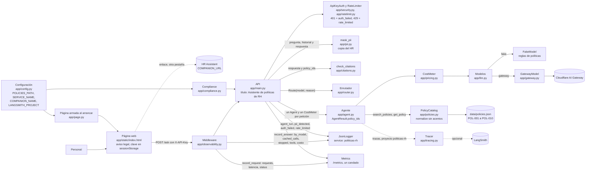
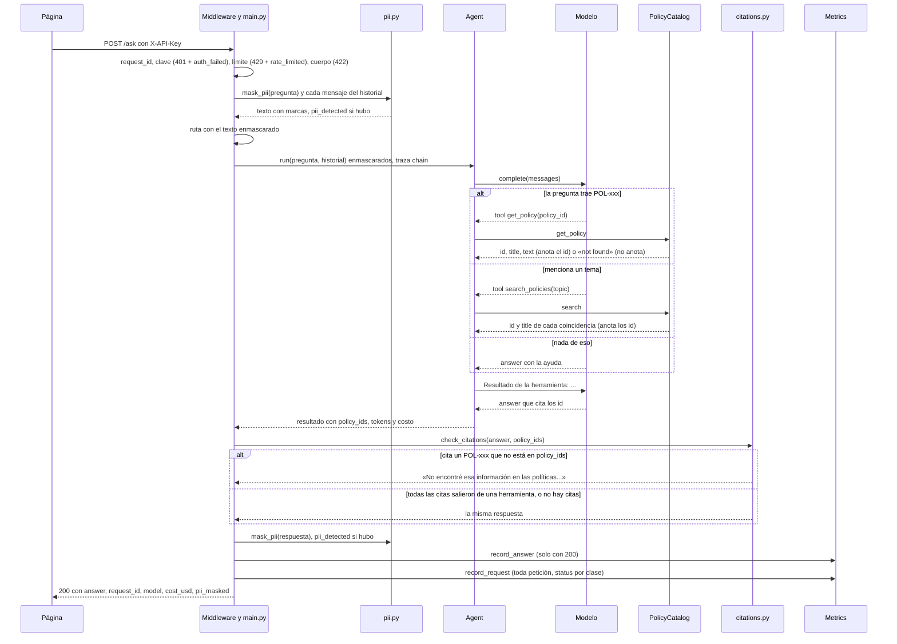
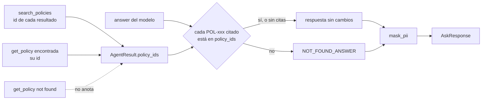
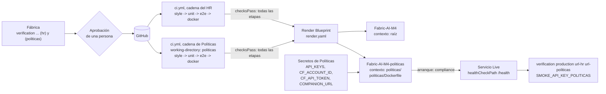
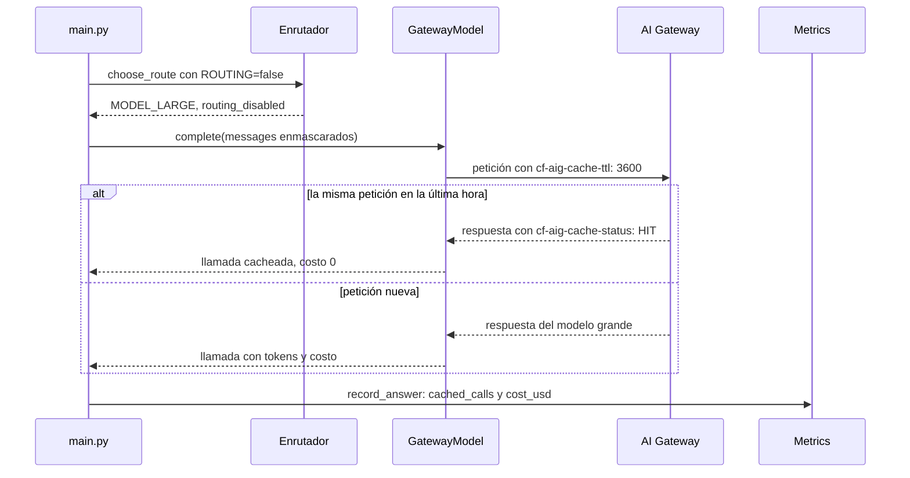

# Arquitectura del Asistente de políticas de RH

Asistente que responde preguntas del personal sobre las políticas de la empresa (vacaciones, aguinaldo, jornada,
permisos y otras) y cita siempre la política que usó. Es el HR Assistant de `product/` con otros datos, otras dos
herramientas y otro modelo simulado (especificación 06). Hereda sus decisiones: los ADR 0001 a 0018 del HR
Assistant (`product/doc/adr/`) valen igual aquí. Vive en `product/politicas/` y se publica como un servicio aparte
(ADR 0001), sin importar nada de `product/app/` (ADR 0002). Desde la especificación 07, `/metrics` agrega las
métricas de negocio con el mismo comportamiento que el HR (ADR 0015 y 0016 del HR). Desde la especificación 08, en
producción todas las preguntas van al modelo grande y las respuestas del gateway se guardan en caché una hora
(ADR 0017 del HR); el código no cambia. Desde la especificación 09, los datos personales se enmascaran igual que en
el HR, el log audita los rechazos y la PII, y una respuesta que cita una política que ninguna herramienta devolvió
en esa petición se reemplaza por un texto fijo (ADR 0018 del HR).

## Componentes

## Una pregunta a `/ask`

## Citas validadas

Desde la especificación 09 (ADR 0018 del HR). Solo cuenta como devuelto un id que el catálogo entregó en esta
petición: un «Policy POL-999 not found» no cuenta, ni una política que vino en el historial. La regla no tiene
excepciones, así que la ayuda del modelo simulado, que trae `(POL-001)` como ejemplo sin consultar una
herramienta, también se reemplaza por el texto fijo, que da la misma guía. La validación corre una vez y antes de
enmascarar: el texto de reemplazo trae `POL-001` y no se vuelve a revisar.

## Del código a producción

## Configuración de producción

`render.yaml` fija para `Fabric-AI-M4-politicas` `ROUTING=false` y `CACHE_TTL_SECONDS=3600` (ADR 0017 del HR).
Con el enrutamiento, el modelo pequeño no pidió ninguna herramienta en 0 de 9 casos de la medición con el modelo
real; sin él, la calidad fue igual a la línea base y el costo bajó 10 %. La caché es segura aquí porque Políticas
responde reglas generales sin datos de personas, sus preguntas se repiten y una política cambia pocas veces al año.
El HR no lleva caché. Desde la especificación 09 la caché solo recibe texto enmascarado: si la persona escribe un
dato suyo, a Cloudflare llega la marca, no el valor.

En desarrollo, en las pruebas y en `verification evaluate` siguen los valores por omisión (`ROUTING=true`,
`CACHE_TTL_SECONDS=0`). Una respuesta de la caché puede tener hasta una hora de antigüedad y la caché es común a
todos los clientes del servicio.

## Módulos copiados y adaptados (ADR 0002)

| Estado | Módulos de `app/` |
| --- | --- |
| Copiados del HR sin cambios de lógica | `clock`, `errors`, `logs`, `metrics`, `observability`, `protocol`, `router`, `pricing`, `security`, `ratelimit`, `compliance`, `page`, `pii` |
| Adaptados | `agent` (herramientas y `policy_ids`), `llm` (modelo simulado), `gateway` (`SYSTEM_PROMPT`), `config` (variables), `tracing` (`LANGSMITH_PROJECT`), `main` (título, catálogo y validación de citas), `static/index.html` (textos y aviso) |
| Propios | `policies` (en lugar de `directory`), `citations` |

Un arreglo en un módulo copiado se hace también en el otro producto. En la especificación 07, `metrics.py` cambia
igual en los dos productos y sigue siendo copia; `log_agent_run` de `main.py` cambia igual en los dos. En la
especificación 08 ningún módulo cambia. En la especificación 09, `pii.py` nace como copia idéntica, y el
enmascaramiento y la auditoría de `main.py` cambian igual en los dos; `citations.py` y `policy_ids` son solo de
Políticas.

## Principios

- Todo lo del HR Assistant: sin estado, bucle con tope, herramientas de solo lectura, `request_id` y log JSON sin
  texto de preguntas, métricas por proceso, costo medido, claves por cliente, límite, compliance al arrancar,
  concurrencia con candados, enlace armado al arrancar, métricas de negocio en la misma `Metrics`, configuración
  de costos de producción y datos personales enmascarados con auditoría de rechazos (ADR 0001 a 0018 del HR).
- Servicio aparte en el mismo repositorio, con su propio contexto de Docker y sus propias etapas de CI (ADR 0001).
- Ningún import de `product/app/`: los módulos se copian (ADR 0002).
- Un tema coincide si un `topic` o una `keyword`, sin acentos ni mayúsculas, es igual a él o está dentro; la
  respuesta cita los `id` (ADR 0003).
- Solo se cita lo que devolvió una herramienta en la misma petición; si no, texto fijo (ADR 0018 del HR).
- Políticas ficticias de ejemplo; la página lo dice y no son asesoría legal.

## Variables propias de Políticas

Las demás variables y sus valores por omisión son los del HR Assistant. Las especificaciones 07, 08 y 09 no
agregan variables; la 08 fija en `render.yaml` `ROUTING=false` y `CACHE_TTL_SECONDS=3600` para este servicio.

| Variable | Por omisión | Dónde actúa |
| --- | --- | --- |
| `POLICIES_PATH` | `data/policies.json` | `config.py` y `policies.py`; reemplaza a `EMPLOYEES_PATH` |
| `SERVICE_NAME` | `politicas-rh` | Campo `service` del log |
| `COMPANION_NAME` | `HR Assistant` | `page.py`; texto del enlace |
| `COMPANION_URL` | vacía | `page.py`; en Render, secreto con `sync: false` |
| `LANGSMITH_PROJECT` | `politicas-rh` | `tracing.py`; proyecto de las trazas |

## Dónde mirar

- Log: salida estándar del servicio `Fabric-AI-M4-politicas` en Render; se filtra por `request_id` o `client`, y
  por `auth_failed`, `rate_limited` y `pii_detected` para los rechazos y la PII.
- Métricas: `GET /metrics` con una clave de Políticas. Uso y costo por modelo en `by_model`, `search_policies` y
  `get_policy` en `tools`, respuestas cortadas en `stopped`, caché en `cached_calls` y clases de código en
  `status`. En producción `by_model` solo muestra `MODEL_LARGE` y `cached_calls` cuenta las llamadas servidas por
  la caché del gateway, que no suman costo.
- Respuestas de `/ask` en producción: `route` es `routing_disabled`; `cached_calls` mayor que 0 indica que la
  respuesta salió de la caché; `pii_masked` lista los tipos enmascarados. Una respuesta igual a «No encontré esa
  información en las políticas...» indica una cita que ninguna herramienta respaldó.
- Configuración de producción: `render.yaml`, servicio `Fabric-AI-M4-politicas`; la comprueba
  `verification/contract/test_contract_08.py`.
- PII y auditoría: `verification/contract/test_contract_09_politicas.py`; controles en
  `doc/compliance-checklist.md`.
- Documentación de la API: Swagger en `/docs`, con el título «Asistente de políticas de RH».
- Pipeline: las etapas `*-politicas` en la pestaña Actions.
- Producción: `uv run python -m verification production <url-hr> <url-politicas>` con `SMOKE_API_KEY` y
  `SMOKE_API_KEY_POLITICAS` en el entorno. El `scripts/smoke.py` propio de Políticas lee la clave de
  `SMOKE_API_KEY`, como el del HR.
